# AAMS — Automated Attendance Management System

[](https://www.php.net/)
[](https://www.sqlite.org/)
[](https://aws.amazon.com/rekognition/)
[](https://getbootstrap.com/)
[](LICENSE)
[](assets/academic_files/project_report.pdf)

> **Automated Attendance Management System Through Face Recognition with Deep Learning and Cloud-Based Image Processing Techniques**  
> *Major Project Submission for Bachelor of Technology in Computer Science & Engineering*  
> **Author:** Abinash Patra (Regd. No: `23LBTCSE01`)  
> **Supervisor:** Mr. Pradyumna Kumar Ratha, Assistant Professor, Department of CSE  
> **Institution:** Sambalpur University Institute of Information Technology (SUIIT), Burla, Odisha, India (May 2026)

---

## 📖 Table of Contents

- [Overview](#-overview)
- [Key Features](#-key-features)
- [System Architecture](#-system-architecture)
- [Workflow Diagrams](#-workflow-diagrams)
- [Role-Based Access Control (RBAC)](#-role-based-access-control-rbac)
- [Screenshots & UI Walkthrough](#-screenshots--ui-walkthrough)
- [Experimental Results & Performance](#-experimental-results--performance)
- [Database Schema & Architecture](#-database-schema--architecture)
- [Prerequisites & System Requirements](#-prerequisites--system-requirements)
- [Step-by-Step Installation Guide](#-step-by-step-installation-guide)
- [AWS Rekognition Configuration](#-aws-rekognition-configuration)
- [Default Login Credentials](#-default-login-credentials)
- [Project Directory Structure](#-project-directory-structure)
- [Security & Data Integrity](#-security--data-integrity)
- [Academic Assets](#-academic-assets)
- [License & Acknowledgments](#-license--acknowledgments)

---

## 🌟 Overview

Conventional attendance management in academic institutions—such as calling roll numbers manually or passing physical attendance sheets—suffers from severe drawbacks:
- Consumes **10–15 minutes** of valuable instructional lecture time.
- Highly vulnerable to **proxy attendance** and fraudulent entries.
- Prone to human error, record misplacement, and delayed analytics.
- Traditional fingerprint biometric systems introduce hygiene concerns, physical queues, and high hardware maintenance overhead.

**AAMS (Automated Attendance Management System)** solves these challenges through an end-to-end, contactless web platform powered by **AWS Rekognition** deep learning facial recognition services. A single classroom image captured by the instructor via a webcam or smartphone camera is processed in the cloud to detect and match multiple student faces simultaneously within seconds.

Attendance records are automatically time-stamped and stored with confidence scores, creating an immutable, tamper-resistant audit trail with controlled manual fallback options.

---

## 🚀 Key Features

- 📸 **Cloud-Powered Face Recognition**: Leverages AWS Rekognition for facial detection, facial feature extraction, and high-accuracy matching against enrolled student collections.
- 👥 **Simultaneous Multi-Face Detection**: Detects and marks attendance for multiple students from a single classroom photograph, with intelligent individual bounding-box cropping fallback via the PHP GD library.
- ⏱️ **Real-Time & Live Attendance**: Supports single snapshot marking and continuous real-time video stream capture via WebRTC and HTML5 Canvas (`attendance/live_attendance.php`).
- 📂 **Mass Student Registration**: Bulk CSV import (Name, Email, Roll Number, Initial Password) with simultaneous batch photo upload and automated AWS Rekognition collection indexing.
- 🛡️ **Role-Based Access Control (RBAC)**: Distinct, secure portals and permissions for **Administrators**, **Teachers**, and **Students**.
- 🏫 **Hierarchical Academic Structure**: Seamless management of Branches (Departments), Semesters, Classes/Subjects, and Course Allocations.
- 📊 **Comprehensive Analytics & Reporting**: Filter attendance by date, date range, class, or individual student. Includes live attendance percentages and exportable/printable reports.
- 🔄 **Controlled Manual Fallback**: Allows teachers to manually mark or adjust attendance with audit logging in exceptional scenarios (e.g., poor lighting, occluded faces).
- 🔒 **Enterprise-Grade Security**: CSRF protection on all POST requests, bcrypt password hashing, PDO prepared statements, and session tampering safeguards.

---

## 🏗️ System Architecture

AAMS is structured as a **4-Tier Client-Server Architecture** with cloud AI integration:

```
┌────────────────────────────────────────────────────────────────────────┐
│                        Presentation Layer (Frontend)                   │
│         HTML5  •  CSS3  •  JavaScript (ES6)  •  Bootstrap 5.3          │
│            WebRTC Camera Interface  •  Canvas Capture  •  AJAX         │
└───────────────────────────────────┬────────────────────────────────────┘
                                    │ HTTPS / REST
┌───────────────────────────────────▼────────────────────────────────────┐
│                       Application Layer (PHP 8.x)                      │
│  ┌──────────────────┐  ┌──────────────────┐  ┌───────────────────────┐ │
│  │   Auth & RBAC    │  │ Academic Manager │  │   Attendance Engine   │ │
│  │  (User / CSRF)   │  │ (Branch/Sem/Cls) │  │  (Live / Mark / API)  │ │
│  └──────────────────┘  └──────────────────┘  └───────────┬───────────┘ │
│  ┌──────────────────┐  ┌──────────────────┐              │             │
│  │  Student Module  │  │ Reporting Engine │              │             │
│  │ (Single / Bulk)  │  │(Filters/Analytics│              │             │
│  └────────┬─────────┘  └──────────────────┘              │             │
└───────────┼──────────────────────────────────────────────┼─────────────┘
            │ AWS SDK for PHP                              │
┌───────────▼──────────────────────────────────────────────▼─────────────┐
│                       Cloud Processing Layer (AWS)                     │
│               AWS Rekognition (Collection: db_aams)                    │
│   • detectFaces       • indexFaces       • searchFacesByImage          │
└───────────────────────────────────┬────────────────────────────────────┘
                                    │ Local Storage & Persistence
┌───────────────────────────────────▼────────────────────────────────────┐
│                        Data & Storage Layer                            │
│           SQLite3 Relational Database  (`db/attendance.db`)            │
│       File Storage: Uploaded Faces, Class Captures, Session Logs       │
└────────────────────────────────────────────────────────────────────────┘
```

---

## 🔄 Workflow Diagrams

### 1. Automated Attendance Marking Workflow

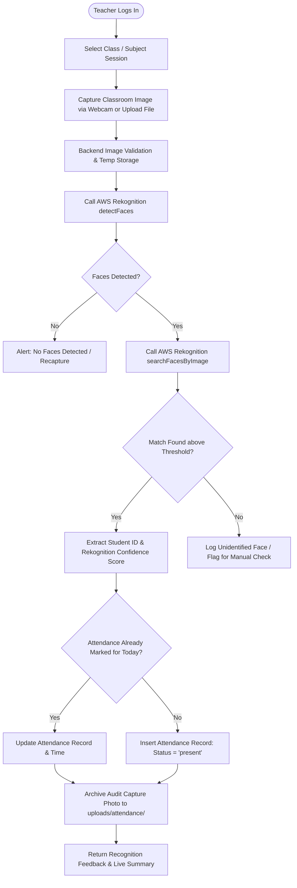

### 2. Student Bulk Enrollment & Face Indexing Workflow

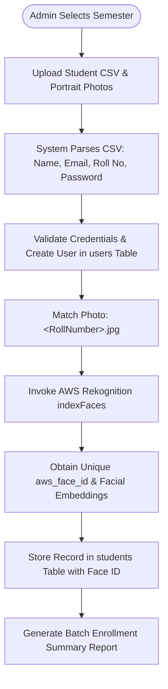

---

## 👥 Role-Based Access Control (RBAC)

The system enforces strict permission separation across three distinct roles:

| Module / Privilege | Administrator | Teacher | Student |
| :--- | :---: | :---: | :---: |
| **System Dashboard & Global Statistics** | ✅ Full Access | ❌ | ❌ |
| **Branch & Semester Management** | ✅ Full Access | ❌ | ❌ |
| **Class Creation & Teacher Allocation** | ✅ Full Access | ❌ | ❌ |
| **User Management (Admin/Teacher/Student)** | ✅ Full Access | ❌ | ❌ |
| **Mass Student CSV Registration** | ✅ Full Access | ❌ | ❌ |
| **Single Student Face Registration** | ✅ Full Access | ✅ Allowed | ❌ |
| **View Assigned Classes & Rosters** | ✅ All Classes | ✅ Own Classes | ❌ |
| **Mark Attendance (Face Recognition)** | ✅ Allowed | ✅ Assigned Classes | ❌ |
| **Live Continuous Attendance Capture** | ✅ Allowed | ✅ Assigned Classes | ❌ |
| **Manual Attendance Fallback** | ✅ Allowed | ✅ Assigned Classes | ❌ |
| **Attendance Reports & Analytics** | ✅ Institution-wide | ✅ Assigned Classes | ✅ Self Only |
| **Personal Attendance Stats & Percentage** | ❌ | ❌ | ✅ Own Records |
| **Profile & Password Management** | ✅ Own Profile | ✅ Own Profile | ✅ Own Profile |

---

## 📸 Screenshots & UI Walkthrough

All screenshots are stored in [`assets/screenshots/`](assets/screenshots/):

### Authentication & Dashboards
| Login Portal | Administrator Dashboard |
| :---: | :---: |
| 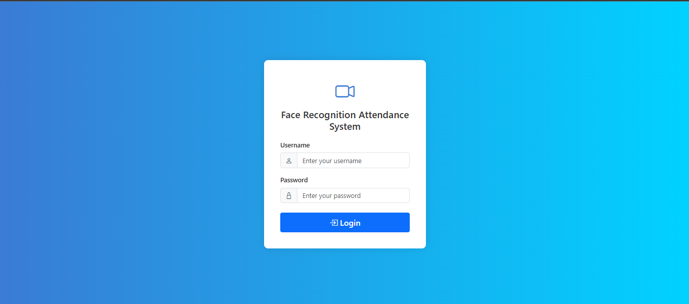 | 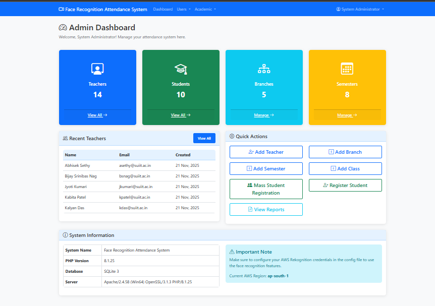 |
| *Clean login interface with CSRF validation & role routing* | *Overview counters for teachers, students, branches, & classes* |

| Teacher Dashboard | Student Dashboard |
| :---: | :---: |
| 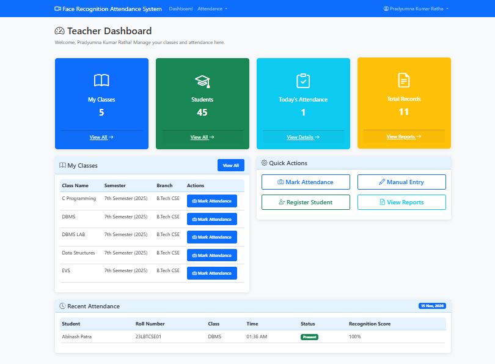 | 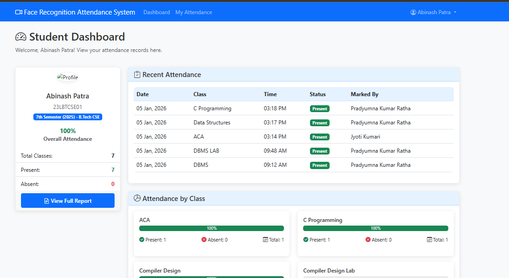 |
| *Teacher overview with assigned classes and today's attendance stats* | *Student portal showing personal attendance % and subject breakdown* |

---

### Academic Management & Student Registration
| Academic Management | Mass Student Registration |
| :---: | :---: |
| 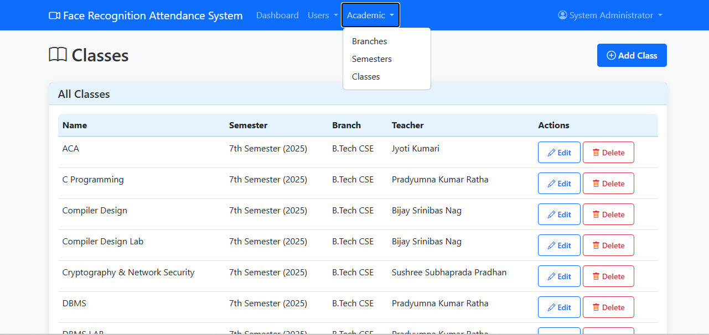 | 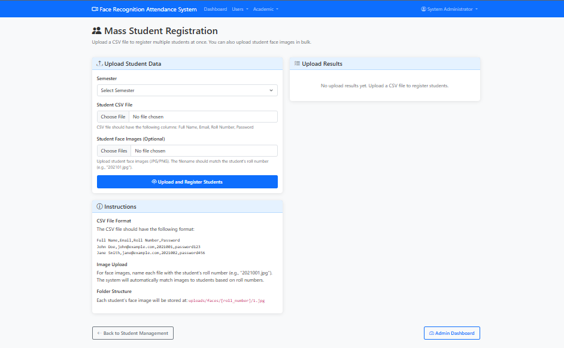 |
| *Manage departments/branches, semesters, and subjects* | *Batch CSV enrollment with multi-image face indexing* |

| Single Student Registration | Assigned Classes View |
| :---: | :---: |
| 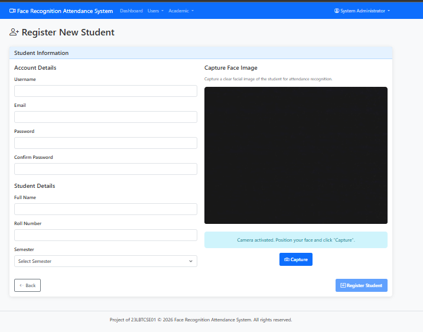 | 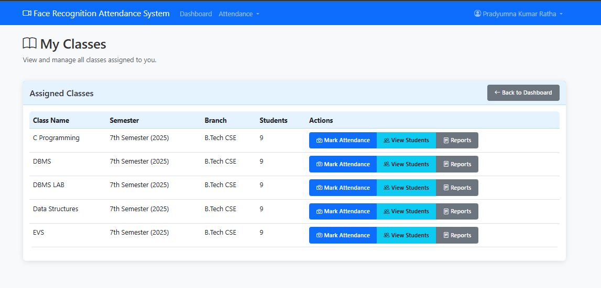 |
| *Individual student enrollment with live webcam capture* | *Teacher's enrolled class schedule and semester student rosters* |

---

### Attendance Operations & Reporting
| Face Recognition Attendance | Manual Attendance Fallback |
| :---: | :---: |
| 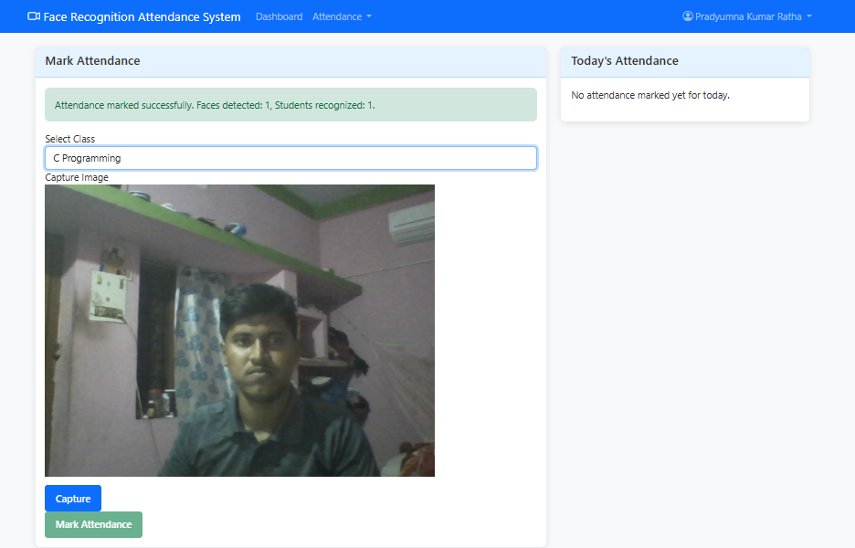 | 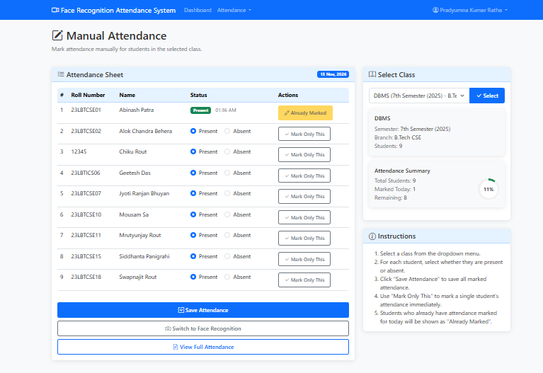 |
| *Instant classroom image capture with detected face matches & scores* | *Controlled manual fallback with Present/Absent status toggles* |

| Teacher Attendance Reports | Administrator Audit Reports |
| :---: | :---: |
| 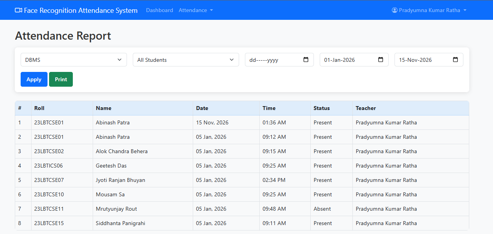 | 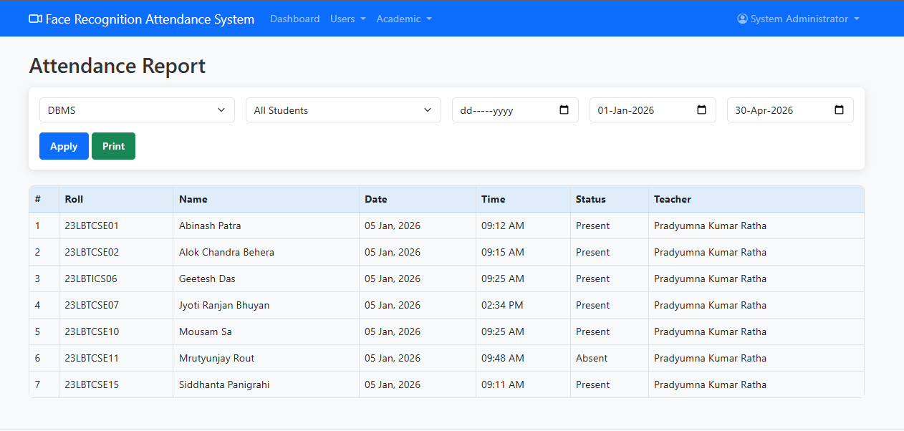 |
| *Filter by date range, class, and student with print/PDF export* | *Global attendance monitoring and institution-wide compliance records* |

---

## 📊 Experimental Results & Performance

*(Source: Project Evaluation Report, Department of Computer Science & Engineering, SUIIT)*

### Quantitative Accuracy Metrics
| Evaluation Parameter | Result | Empirical Observation |
| :--- | :---: | :--- |
| **Face Recognition Accuracy** | **95.8%** | High precision for frontal faces under standard classroom lighting |
| **Attendance Marking Accuracy** | **97.2%** | High reliability across diverse classroom cohorts |
| **Duplicate Attendance Prevention** | **100%** | Guaranteed by composite database unique constraints |
| **Proxy Attendance Prevention** | **~100%** | Biometric verification eliminates physical signature sharing |

### System Response Times by Classroom Size
| Class Size | Average Response Time |
| :--- | :---: |
| **20 Students** | 1.1 seconds |
| **35 Students** | 1.4 seconds |
| **50 Students** | 1.8 seconds |

### Efficiency Comparison
- **Time Reduction**: Reduces classroom attendance time by approximately **90%** compared to manual roll call methods.
- **Hardware Agnostic**: Runs in any modern web browser on standard laptops or smartphones with an integrated camera—eliminating specialized biometric terminal costs.

---

## 🗄️ Database Schema & Architecture

The application uses **SQLite3** (`db/attendance.db`). The schema is defined in [`db/schema.sql`](db/schema.sql):

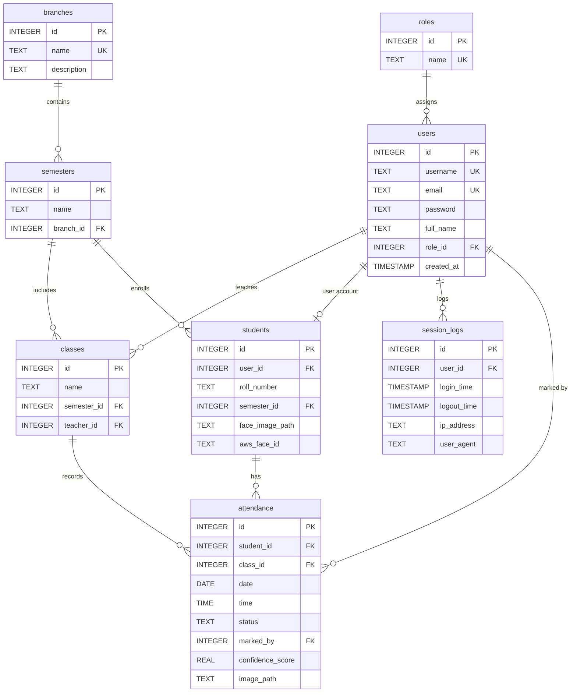

---

## ⚙️ Prerequisites & System Requirements

### Server Requirements
- **PHP**: `7.4` or `8.0+` (PHP 8 recommended)
- **PHP Extensions**:
  - `pdo_sqlite` / `sqlite3`
  - `gd` or `imagick` (for face cropping and image resizing)
  - `curl` & `openssl` (for AWS SDK communication)
  - `mbstring` & `json`
- **Composer**: Dependency Manager for PHP
- **Web Server**: Apache 2.4+ (with `mod_rewrite`) or Nginx, or local stacks like XAMPP / WAMP / Laragon
- **AWS Account**: With permissions to access **Amazon Rekognition**

### Client / Browser Requirements
- Any modern web browser (Google Chrome, Mozilla Firefox, Microsoft Edge, Safari)
- Camera permissions enabled for HTTPS or `localhost`

---

## 💻 Step-by-Step Installation Guide

### Step 1: Clone the Repository
```bash
git clone https://github.com/abinash021/AAMS.git
cd AAMS
```

### Step 2: Install Dependencies via Composer
```bash
composer install
```

### Step 3: Configure AWS Credentials & Application Settings
Open [`config/config.php`](config/config.php) and configure your environment settings:

```php
// Site URL
define('BASE_URL', 'http://localhost/AAMS');

// AWS Rekognition Credentials
define('AWS_KEY', 'YOUR_AWS_ACCESS_KEY_ID');
define('AWS_SECRET', 'YOUR_AWS_SECRET_ACCESS_KEY');
define('AWS_REGION', 'ap-south-1');            // e.g., ap-south-1 (Mumbai) or us-east-1
define('AWS_COLLECTION_ID', 'db_aams');        // Your Rekognition collection identifier
```

### Step 4: Initialize the SQLite Database
Run the database initialization script to create all tables and generate the default administrator:

```bash
php db/init_db.php
```

*Expected output:*
```text
Database connected successfully.
Database schema created successfully.
Default admin user created successfully.
```

### Step 5: Configure File & Directory Permissions
Ensure upload folders and the SQLite database file have write permissions:

**On Linux / macOS:**
```bash
chmod -R 775 uploads/
chmod 777 db/attendance.db
```

**On Windows (PowerShell):**
```powershell
icacls "uploads" /grant Everyone:(OI)(CI)F /T
icacls "db\attendance.db" /grant Everyone:F
```

### Step 6: Start Your Local Web Server

**Using PHP Built-in Server (Development):**
```bash
php -S localhost:8000
```
Then browse to `http://localhost:8000`.

**Using XAMPP:**
Place the `AAMS` directory inside `C:\xampp\htdocs\AAMS` and access `http://localhost/AAMS`.

---

## ☁️ AWS Rekognition Configuration

### 1. Required IAM Policy
Ensure your AWS IAM User has the following minimum IAM policy attached:

```json
{
    "Version": "2012-10-17",
    "Statement": [
        {
            "Effect": "Allow",
            "Action": [
                "rekognition:CreateCollection",
                "rekognition:DescribeCollection",
                "rekognition:ListCollections",
                "rekognition:IndexFaces",
                "rekognition:SearchFacesByImage",
                "rekognition:DetectFaces",
                "rekognition:DeleteFaces",
                "rekognition:ListFaces"
            ],
            "Resource": "*"
        }
    ]
}
```

### 2. Automatic Collection Initialization
The application automatically creates the collection specified in `AWS_COLLECTION_ID` (e.g. `db_aams`) on the first call to `createCollectionIfNotExists()`. Alternatively, you can create it via the AWS CLI:

```bash
aws rekognition create-collection --collection-id "db_aams" --region "ap-south-1"
```

---

## 🔑 Default Login Credentials

After initializing the database via `php db/init_db.php`, log in with:

| Parameter | Default Value |
| :--- | :--- |
| **URL** | `http://localhost/AAMS/login.php` |
| **Username** | `admin` |
| **Password** | `admin123` |
| **Role** | System Administrator |

> ⚠️ **Important:** Change the default admin password immediately after first login via the **Profile** section (`profile.php`).

---

## 📁 Project Directory Structure

```text
PROJECT_AAMS/
├── admin/                         # Administrator Portal
│   ├── branches.php               # Department / Branch CRUD management
│   ├── classes.php                # Class creation and teacher allocation
│   ├── dashboard.php              # Admin analytics dashboard
│   ├── mass-students.php          # Bulk CSV + facial photos registration
│   ├── semesters.php              # Semester management per branch
│   └── users.php                  # User account management (Admin/Teacher/Student)
├── assets/                        # Static Assets
│   ├── academic_files/            # Academic Project Documentation
│   │   ├── project_ppt.pdf        # Final Project Defense Presentation Slides
│   │   └── project_report.pdf     # Full B.Tech Major Project Thesis Report
│   ├── css/
│   │   └── style.css              # Custom styles & responsive layout
│   ├── js/
│   │   └── script.js              # Client-side validation & camera interaction
│   └── screenshots/               # Application UI Screenshots for documentation
│       ├── admin_academicmanagement.png
│       ├── admin_dashboard.png
│       ├── admin_massstudentregistration.png
│       ├── admin_register_student.png
│       ├── admin_viewreport.png
│       ├── login.png
│       ├── student_dashboard.png
│       ├── teacher_classes.png
│       ├── teacher_dashboard.png
│       ├── teacher_manualattendance.png
│       ├── teacher_markattendance.png
│       └── teacher_viewreport.png
├── attendance/                    # Attendance Engine & Reporting
│   ├── api.php                    # JSON endpoint for face recognition attendance
│   ├── live_attendance.php        # Real-time WebRTC live video attendance
│   ├── manual.php                 # Controlled manual attendance fallback
│   ├── mark.php                   # Snapshot-based attendance capture
│   └── report.php                 # Attendance reporting with filters & PDF print
├── config/
│   └── config.php                 # System configuration, database & AWS keys
├── db/
│   ├── attendance.db              # SQLite database storage file
│   ├── init_db.php                # Database initialization script
│   └── schema.sql                 # SQL table schemas & constraints
├── face/                          # Sample dataset for bulk registration
│   ├── file.csv                   # Sample bulk student CSV template
│   └── ...                        # Sample student portrait photos
├── includes/                      # Core Backend Classes & Helpers
│   ├── Academic.php               # Academic entities model (Branch, Sem, Class)
│   ├── Attendance.php             # Core attendance business logic
│   ├── Database.php               # Singleton PDO wrapper for SQLite
│   ├── error.php                  # Graceful fatal error handling page
│   ├── footer.php                 # Common footer template
│   ├── functions.php              # Security, CSRF, session & sanitation helpers
│   ├── header.php                 # Dynamic navigation bar & RBAC routing
│   ├── Rekognition.php            # AWS Rekognition SDK wrapper
│   ├── Student.php                # Student model & searchByFace abstraction
│   └── User.php                   # Authentication, user CRUD, & password hashing
├── logs/                          # Error & API logs
├── student/                       # Student Portal
│   ├── api.php                    # Student details API endpoint
│   ├── attendance.php             # Student's complete attendance record view
│   └── dashboard.php              # Student dashboard & percentage metrics
├── students/                      # Student Registration & Roster Views
│   ├── class_students.php         # Semester-wise student roster with pictures
│   └── register.php               # Single student registration with webcam capture
├── teacher/                       # Teacher Portal
│   ├── classes.php                # List of assigned classes
│   └── dashboard.php              # Teacher dashboard with quick attendance actions
├── uploads/                       # User Uploads Storage
│   ├── attendance/                # Time-stamped classroom capture audit images
│   ├── faces/                     # Registered student face portraits
│   ├── students/                  # Profile pictures
│   └── temp/                      # Temporary capture buffer for recognition
├── .gitattributes
├── composer.json                  # PHP dependency configuration (AWS SDK)
├── composer.lock                  # Locked package versions
├── index.php                      # Application entry point & landing page
├── LICENSE                        # MIT Open Source License
├── login.php                      # User authentication page
├── logout.php                     # Session termination script
├── profile.php                    # User profile and password update page
└── README.md                      # Comprehensive project documentation
```

---

## 🔒 Security & Data Integrity

1. **CSRF Protection**: All form submissions and asynchronous operations validate cryptographic anti-CSRF tokens (`generateCsrfToken()`, `validateCsrfToken()`).
2. **Password Security**: Passwords are saved using standard PHP `password_hash()` utilizing **bcrypt** algorithms with dynamic cost factors.
3. **SQL Injection Defense**: All database queries are executed using **PDO Prepared Statements** with parameterized inputs (`:param` / `?`).
4. **Session Hardening**: Configured with `session.cookie_httponly = 1` and `session.use_only_cookies = 1` to prevent XSS session cookie theft.
5. **Immutable Records**: Attendance records are permanently written with date, time, confidence score, and audit capture image path; duplicate entries for the same student on the same date are rejected by database unique constraints.
6. **Upload Validation**: File uploads are strictly validated by file extension, MIME type (`getimagesize`), and file size limits (5MB).

---

## 🎓 Academic Assets & Project Citation

This repository contains the complete major project documentation submitted to Sambalpur University Institute of Information Technology:

- 📄 **Full Project Report (Thesis)**: [`assets/academic_files/project_report.pdf`](assets/academic_files/project_report.pdf)
- 📊 **Project Defense Presentation**: [`assets/academic_files/project_ppt.pdf`](assets/academic_files/project_ppt.pdf)

### Citation
```bibtex
@mastersthesis{patra2026aams,
  title     = {Automated Attendance Management System Through Face Recognition with Deep Learning and Cloud-Based Image Processing Techniques},
  author    = {Abinash Patra},
  school    = {Sambalpur University Institute of Information Technology (SUIIT)},
  department= {Department of Computer Science and Engineering},
  address   = {Jyoti Vihar, Burla, Sambalpur, Odisha, India},
  year      = {2026},
  month     = {May}
}
```

---

## 📜 License & Acknowledgments

### License
This project is licensed under the **MIT License** — see the [LICENSE](LICENSE) file for details.

### Acknowledgments
- [AWS SDK for PHP](https://github.com/aws/aws-sdk-php) for cloud face recognition integration.
- [Bootstrap 5](https://getbootstrap.com/) & [Bootstrap Icons](https://icons.getbootstrap.com/) for UI components.
- Faculty members and peers of the **Department of Computer Science and Engineering, SUIIT**, Burla, Odisha.
